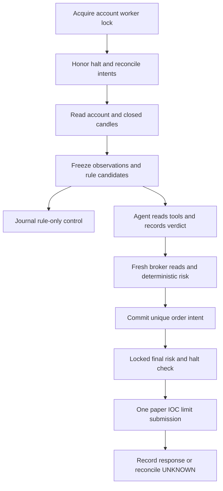

# Glitter

A small, auditable, agent-vetted **Alpaca paper trading** system for the Glitter Labs take-home.
One Python service, one bounded Groq agent, deterministic risk checks, durable order intents,
and a Robinhood-inspired dashboard. No live brokerage endpoint exists in this code.

## Start locally

1. Copy `.env.example` to `.env` **in the repository root**, beside `pyproject.toml`.
2. Fill in `ALPACA_API_KEY`, `ALPACA_SECRET_KEY`, `GROQ_API_KEY`, and a private `DASHBOARD_TOKEN`.
3. Start with Docker Desktop / Docker Compose:

```bash
docker compose up --build -d
```

Open **http://localhost:8000** and enter your dashboard token. The worker starts automatically,
checks every 15 minutes, and considers one decision per completed UTC hour. SQLite persists in
a Docker volume. Keep the machine running; Docker is not a remote hosting service.

The default is read-only. Before unattended execution, explicitly consent to sharing account
context with Groq by setting `AGENT_ACCOUNT_CONTEXT_ENABLED=true`, then set
`EXECUTION_ENABLED=true` and recreate the container. Account context includes equity, cash,
buying power, positions and open orders; API credentials are never model inputs. The transfer
gate defaults to false. `glitter-check` uses public market data only in its model request.

For Linux/WSL with Python 3.12+ and [uv](https://docs.astral.sh/uv/):

```bash
uv sync --frozen
uv run glitter-check
uv run glitter-serve
```

`glitter-serve` is the single application command: dashboard plus unattended worker. Run one
web worker. SQLite requires Linux/WSL file locking; native Windows users should use Docker.

## Credentials

| Variable in root `.env` | Value |
|---|---|
| `ALPACA_API_KEY` | Alpaca **paper** API key ID |
| `ALPACA_SECRET_KEY` | Matching paper secret key |
| `GROQ_API_KEY` | Groq API key |
| `DASHBOARD_TOKEN` | Your own long, random dashboard password |
| `DATABASE_URL` | Default SQLite file, or direct/session-pooler PostgreSQL URL |
| `AGENT_ACCOUNT_CONTEXT_ENABLED` | Explicit account-context transfer opt-in, default `false` |
| `EXECUTION_ENABLED` | Permit paper orders, default `false` |

`.env` is ignored by Git and Docker build context. Never paste keys into source, screenshots,
logs, the model prompt, or an assessment submission. Use TLS if exposing the dashboard beyond
localhost; the Compose port binds only to loopback. Do not put secrets in a URL.

## What happens each cycle



BTC/USD and ETH/USD; hourly EMA(8,24), 10 bps hysteresis; 4-hour EMA(6,18), RSI,
ATR, returns, volatility and quote spread as agent context. These are frozen engineering
defaults, **not optimized or proven profitable**. Entry candidates are generated only when flat.
The agent approves/vetoes entries. Rule exits are reviewed but cannot be blocked by a model
failure or veto. Risk checks still apply to exits, and HALTED blocks every automated order.

Default caps: 1% equity per new order, 2% per symbol, 4% total exposure, two entry attempts
per symbol per UTC day, 1% observed daily-loss halt, 2% observed peak drawdown halt. No margin
or shorting. IOC limit prices cap execution price; orders can fill partially or not at all.
The loss reference is the first observed equity in each UTC day, not a fabricated midnight
mark. Loss latches persist across restart and day rollover. Halts do not guarantee a loss ceiling.

## Commands

| Command | Purpose |
|---|---|
| `uv run glitter-check` | Real broker read checks plus public-data model tool loop; never submits |
| `uv run glitter-serve` | Dashboard and 15-minute worker |
| `uv run glitter-cycle` | One reconciliation/decision cycle for an external scheduler |
| `uv run glitter-halt` | Persist HALTED, then request cancellation of open paper orders |
| `uv run glitter-experiment` | Paired rule-versus-agent analysis and isolated model comparison |
| `uv run glitter-report` | Export broker orders, activities, equity, benchmark and journal |
| `uv run pytest` | Unit, failure-injection, API and experiment tests |

With Compose, run a command in the existing container, for example
`docker compose exec glitter /app/.venv/bin/glitter-halt`.

`reports/latest/` contains private generated evidence. Set `REPORT_START` and `REPORT_END`
to UTC ISO8601 timestamps if needed. Intraday report windows are limited to 29 days.
`EXPERIMENT_LIMIT` caps replay observations; start small to avoid exhausting model quotas.
Optional `RUN_PORTFOLIO_REPLAY=true` additionally runs two independent simulated portfolios.
Simulation reruns the treatment agent on its own holdings and cash; it never submits orders.

## Scheduled hosting

The local service is sufficient for the brief's one-command option. For GitHub Actions,
configure a persistent PostgreSQL database and repository secrets named `ALPACA_API_KEY`,
`ALPACA_SECRET_KEY`, `GROQ_API_KEY`, `DATABASE_URL`. Use a **direct or session-pooler** URL
with TLS, not a transaction pooler on port 6543. Then explicitly set repository variables
`AGENT_ACCOUNT_CONTEXT_ENABLED=true` and `TRADING_SCHEDULE_ENABLED=true`.

The schedule is offset to minutes 7, 22, 37, 52. GitHub may delay/drop scheduled runs; coverage
must be measured. The database, not the GitHub concurrency group, protects manual/local
overlap. Every writer for this account must use the **same database**. Do not concurrently
operate independent databases against the same paper account. The workflow is disabled until
its enable variable is configured. No secrets or hosting resources were provisioned by the code.

Run **Export proof pack** manually in Actions to obtain a private workflow artifact. It does
not send the assessment email. A workflow does not replace the required actual 3+ day run.

## Read the engineering decisions

- [Architecture and failure semantics](docs/ARCHITECTURE.md)
- [Evidence and assessment of the requested repositories](docs/SOURCES.md)
- [Experiments and measurement boundaries](docs/EXPERIMENTS.md)
- [Operating and recovery procedures](docs/RUNBOOK.md)
- [Timestamped build log](docs/BUILD_LOG.md) and [incidents](docs/INCIDENTS.md)
- [Validation status](docs/VALIDATION.md)

The implementation does not claim exactly-once execution across PostgreSQL and Alpaca. It
commits intent first, makes one application-controlled POST attempt, and preserves ambiguous
outcomes for lookup/recovery. It prefers a blocked entry to an unverified duplicate.
