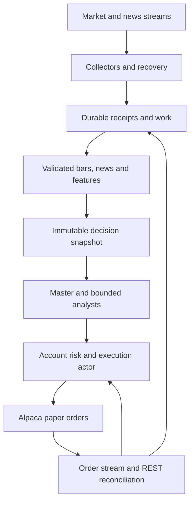

# Realtime trading system: target design and failure analysis

Design date: 14 November 2026, Asia/Kolkata. Status: **target architecture, not a claim that
the current runtime implements or has tested it**. The current runtime is an hourly REST-based
paper trader; its successful CI and unresolved real-order incident remain documented separately.
This design incorporates the new interviewer feedback reported by the user. It is additional to
the attached written assessment, which requires paper-only operation and evidence, not profit.

Companion execution brief: [REALTIME_IMPLEMENTATION_BRIEF.md](REALTIME_IMPLEMENTATION_BRIEF.md).
The brief specifies implementation gates and evidence required before enabling the replacement.

## 1. Scope and first principles

Target profile: one Alpaca **paper** account, an explicit small allowlist of US stocks, continuous
quote/trade/bar ingestion and five-minute strategy decisions. Start with two symbols; configure
the permitted universe after checking actual entitlements. One-minute bars feed features; the
existing hourly BTC/ETH assessment profile remains separately versioned during transition.
Neither equities, five-minute cadence nor a multi-agent policy is silently substituted into its
old performance window. Crypto remains useful for weekend recovery tests; those are not equity
execution tests. No options, shorts, leverage or multi-broker routing in the first release.

Realtime means bounded freshness and continuous supervision. It does not mean an LLM processes
every tick or the system meets an exchange-colocation deadline. Price ingestion, stop controls,
order reconciliation and risk supervision continue while an LLM is busy or unavailable.

An arbitrary dollar-profit goal is a reporting objective, not a feasible guarantee. Never increase
order size, leverage, retry frequency or loss limits to catch up with a target. A configured target
may trigger NO_NEW_RISK after a defined cash-flow-adjusted, fee-aware equity condition, but only
as a versioned policy; default target-driven behavior is disabled. Account drawdown, position
limits and the halt switch dominate every objective. Risk checks cannot guarantee a loss ceiling
through a gap, illiquidity, exchange outage or an already-accepted order.

Use Python for all application services. Add Rust only after measuring a specific numerical or
parsing bottleneck and proving equivalent results. Kafka/PostgreSQL internals are third-party
infrastructure, not reasons to introduce another backend application language.

## 2. Facts that constrain the design

| Verified external fact | Architectural consequence | Source |
|---|---|---|
| Many Alpaca subscriptions allow one connection to a particular endpoint; a second can receive 406. | One shared collector and passive standby per entitled feed; do not give each agent a socket or evade limits with extra keys. | S1 |
| Streaming payloads can batch multiple events; slow clients can be disconnected, with or without warning 407. | A bounded reader and independent durable writer; monitor backlog and reconnect/recover on overflow. | S1 |
| Stock minute bars can receive later updates. | Version bars and recompute affected features; preserve what was actually known at decision time. | S2 |
| Basic stock data and full consolidated data have different entitlements and coverage. | Record IEX/SIP/venue identity; check recent historical access before promising recovery latency. | S3 |
| Crypto streams expose different locations; bars can incorporate quote midpoints and valid zero-volume intervals. | Do not splice exchange locations or reconstruct provider bars naively from trades alone. | S4 |
| Paper trade updates use a separate streaming endpoint and can use binary frames. | Independent order-update adapter, plus REST reconciliation; market-data health is not broker health. | S5 |
| Historical market data and news have paginated HTTP endpoints and access constraints. | Overlap and paginate recovery; test actual feed access. Endpoint availability is not a completeness proof. | S6–S8 |
| News carries article IDs and creation/update timestamps. | Store immutable observed revisions and source provenance, including first availability locally. | S7 |

Sources support these facts. Choices and timing budgets below are engineering proposals to be
validated, not properties promised by a vendor. There is no documented universal resumable
sequence for the listed Alpaca streams that this design assumes can prove every missing tick.

## 3. Topology and ownership

Deploy three independently supervised process roles, initially from the same repository/image:

1. **Collectors/projectors:** market and news sockets, recovery, normalization and numerical
   features. No order credentials in their tool interface and no model calls in their reader loop.
2. **Decision workers:** master/analysts and typed read tools. No broker-write capability.
3. **Execution/supervision:** the sole account writer, durable intents, reservations, controls,
   broker updates and periodic REST reconciliation. Model failures cannot consume its resources.

The dashboard reads durable views and receives bounded UI updates. It cannot become a slow
subscriber that blocks the market collector. Give collectors, execution and dashboard separate
connection pools and resource budgets, even if a small deployment shares a host.

### Storage and transport decision

| Technology | Initial decision | Reason and condition for changing it |
|---|---|---|
| PostgreSQL | Durable authority for normalized market/news data, versioned snapshots, account state, work and trading journal. | Transactions keep state changes and corresponding work atomic. SQL relations fit orders, positions and provenance; JSONB stores variable source payloads. |
| PostgreSQL work/outbox tables | Initial durable dispatch. Notifications may wake workers but are not the durable queue. | Avoid a database-plus-message-broker dual write. Claim independent jobs with row locks; serialize each instrument's projection and each account's execution. |
| Redis | Optional disposable latest-value/UI cache, not required initially. | Rebuild from durable data. Redis loss cannot authorize an order, erase an intent or release a reservation. Streams are a possible transport, not an automatic durability guarantee. |
| Kafka | Deferred until measured capture/replay/fan-out needs justify it. | Use partition ordering and durable replay at larger scale. It does not recover a tick never received from Alpaca or make an external broker POST exactly once. |
| Object storage + Parquet | Archive sealed raw batches and analytical history when retention/volume warrants it. | Cheap replay storage, checksummed and versioned. Never the synchronous authority for spendable cash or current order state. |
| Separate document/vector database | Not initially. | News ID/time/symbol retrieval and optional PostgreSQL full-text search are sufficient until a measured retrieval problem warrants semantic indexing. |

PostgreSQL SKIP LOCKED is suitable for claiming independent work, not obtaining a consistent
portfolio. A busy item must remain pending; a later committed identity/offset must not cause an
earlier unprocessed item to be skipped forever. Commit effects and completion marker together.
If Kafka is introduced: key market topics by source/feed/instrument, not instrument alone;
maintain consumer deduplication and commit database effects with their processed event IDs.
Kafka transactions do not encompass Alpaca. See S9–S12.

## 4. A two-minute market disconnect: exact recovery behavior

The failure domain matters: a second socket on the same server, ISP or upstream feed is not an
independent backup. A passive collector helps process/host failure; historical API repair helps
missed data; another licensed provider helps corroboration/provider failure only where its
semantics are suitable. None makes blind trading safe during a market-data outage.

1. **Detect:** transport ping/pong, expected subscription acknowledgments, per-symbol event
   age, expected completed-bar coverage and local queue age are different signals. A socket
   can be open but stale. A quiet symbol or a closed equity session is not automatically an
   outage; use the exchange calendar and declared feed behavior.
2. **Record and restrict:** persist a gap starting before the last verified coverage boundary,
   mark affected symbols DEGRADED and block new risk. If PostgreSQL cannot record the gap,
   the independent data-freshness/heartbeat gate must still expire in execution. Never rely
   solely on a collector writing an unhealthy flag after it has crashed.
3. **Reconnect:** bounded exponential backoff with full jitter and classified errors. Invalid
   credentials/feed/symbol permissions require intervention, not a tight retry loop. Connection
   limit errors do not justify opening further sockets. Validate the *acknowledged* subscriptions.
4. **Capture current data:** resume the live stream into durable receipts while historical repair
   proceeds independently. Do not stop receiving the new stream while fetching the old gap.
5. **Repair with overlap:** fetch the same feed/location and required data granularity, starting
   before the last durable complete interval through a fixed recovery cutoff. Paginate every
   symbol, validate ordering and schemas, throttle below actual rate limits and handle delayed
   publication. Idempotently merge overlap, including late/corrected versions. Continue live
   capture beyond the cutoff; do not chase an indefinitely moving historical end timestamp.
6. **Prove what is repaired:** for a bar-based strategy, establish calendar-aware required-bar
   coverage, provider agreement through the cutoff, indicator warm-up, no unresolved affecting
   gaps, caught-up projection and a fresh current quote. A REST page returning successfully or
   the newest timestamp advancing is not proof that all intermediate intervals exist.
7. **Rebuild:** recompute recursive indicators from a checkpoint before the earliest repaired
   revision, or from full declared warm-up. Revision changes can affect every later EMA value;
   recalculating only the two missed candles is insufficient. Existing decision snapshots remain
   immutable. Correct the analytical view, never pretend the old agent saw the repaired data.
8. **Reconcile and reopen:** refresh account/orders/fills, invalidate expired proposals and record
   a recovery result. Resume only when the relevant gates pass. Historical signals missed
   during downtime become SKIPPED/MISSED; they are not burst-submitted when the socket returns.

Example: disconnect 10:00:20–10:02:20. Mark the affected minute intervals plus overlap; current
live messages are recorded after reconnection while REST repairs the earlier window. Do not
fill the missing minutes by repeating the 10:00 price. A five-minute candle covering the gap
cannot become eligible solely because its last minute arrived successfully.

If the historical feed is unavailable, delayed by entitlement or inconsistent, stay degraded.
Stock minute bars may be absent because no eligible trade occurred; a calendar alone cannot
certify such a minute. Requery the authoritative feed and apply its documented semantics or
block that strategy. A bar repaired from HTTP is not a recovered original quote/orderbook tape.
For a strategy requiring exact tick/book sequence, unprovable coverage means UNRECOVERABLE
for that window. Reset from an authoritative snapshot where the feed supports it and wait for
new clean warm-up, or stop; do not claim lossless recovery. See S1–S8.

### Secondary providers

Maintain independent provenance and quality comparisons. Configure an explicit, tested fallback
profile with matching instrument, currency, session, adjustments and feature semantics. Switching
IEX to SIP, or Alpaca crypto to Kraken, can change bars and indicators without a price error.
Do not merge conflicting prints or silently splice feeds. A newly selected profile requires its
own warm-up and versioned switch event. Fail closed if the required authoritative feed is absent.
An alternate broker/account is not an automatic execution backup for an existing position.

## 5. Ingestion, processing and timing

**Reader:** authenticate within the provider deadline; decode bounded frames and array lengths;
capture arrival time, connection epoch and ordinal; validate the envelope; enqueue without
waiting for agents, news summarization or feature queries. A dedicated writer performs small
bounded batches, with commit latency and queue age exposed. Preserve original timestamp text
and integer epoch nanoseconds; PostgreSQL/Python datetime precision alone is insufficient for
nanosecond source ordering. Use Decimal for financial normalization and reject non-finite values.

**Durability boundary:** a message is available for trading only after durable capture and
validated projection. Socket receipt is not durable receipt. If a bounded memory queue fills,
mark a gap, close and repair instead of silently dropping. A bounded fsynced local spool can
improve availability, but is not an independent host-loss backup and needs crash/torn-write
tests. Do not introduce an untested spool and call it durable. If retention/repair cannot sustain
load, reduce the configured universe/subscriptions or stop entries.

Storage and computation still proceed concurrently across batches: the writer can persist batch
N+1 while projectors process already-committed batch N. The same individual event must cross
the durable boundary before influencing an executable decision; a parallel fire-and-forget
database write and model call would introduce an unauditable crash window.

**Projection:** retain raw arrivals separately from canonical state. Provider trade IDs must be
scoped using verified feed identity rules; quote timestamps/payload hashes are not assumed
globally unique event IDs. Preserve repeated receipts; make downstream effects idempotent.
Partition work by instrument/feed and enforce single-writer ordering for recursive features.
Late events update history and invalidate dependent future work; they do not retrospectively
alter an already-executed decision. Bar revisions include provenance and availability time.

**Inputs to agents:** calculated indicators, validated bars, quote/spread age, quality/coverage,
account version, eligible candidates, relevant versioned news and explicit missing-data flags.
Provide bounded tools for extra raw candles/news by snapshot ID. Models do not calculate EMA
from thousands of arbitrary JSON ticks or query a changing latest cache during one decision.

**Snapshots:** read related heads in one repeatable-read database snapshot; select only source
versions known by the declared snapshot boundary. Create an immutable snapshot with exact bar,
news and account-version references, feature/policy revisions and expiry. Commit, then release
the transaction before any model call. Snapshot consistency does not imply market freshness;
freshness is checked separately after inference and immediately before execution. See S13.

News is stored before summarization. Store source article ID, publisher URL, created/updated
timestamps, received/available timestamps, original licensed payload, extracted text, related
symbols, content hash and internal revision. Revisions with unchanged publisher timestamps
still get distinct observed versions. Retrieve by symbol, bounded lookback and snapshot time;
deduplicate syndicated content for analysis without deleting source evidence. Fetch late updates
with overlapping historical queries; test endpoint filter semantics rather than assuming filters
mean update time. Missing content, stale coverage or no eligible articles is explicit.

Treat article content as untrusted data: strip active HTML, bound size, quote/delimit text, prevent
arbitrary URL/tool invocation and deny credential access. A text instruction inside news cannot
change the system policy. Model outputs remain schema-checked and provenance-checked. S7–S8
describe the provider records; these controls are our application design.

## 6. Database design

Use PostgreSQL for the realtime deployment. Keep SQLite as the existing single-host legacy/test
profile; do not claim it provides PostgreSQL HA semantics. The table families below are the
target schema, not already-applied migrations. Reuse/migrate current journal records rather
than creating a fresh database to bypass its UNKNOWN intent or HALTED state.

| Table family | Important keys/columns | Constraints, reads and purpose |
|---|---|---|
| instruments / source_profiles | instrument_id; symbol, venue, asset class, quote currency, calendar; provider/feed/location/adjustment | Explicit stable identity and entitlement configuration. Never use bare symbol as cross-provider identity. |
| stream_sessions / receipts | session UUID, source ID, owner generation, frame/item ordinal; event_ns, original source timestamp, received_at, payload/hash | Unique receipt identity per connection/ordinal. Append arrivals; record source event identity only where meaningful. Index source/instrument/time, not every JSON key. |
| gaps / repair_attempts | source, symbol/channel, interval, reason, state; requested bounds, pagination completion, verification result | Track OPEN/REPAIRING/VERIFIED/UNRECOVERABLE and separate bar/tick coverage. An uncertain gap cannot be closed by a later timestamp alone. |
| bar_versions / bar_heads | source+instrument+timeframe+interval start+revision; OHLCV, available_at, raw reference | Immutable versions, validated OHLC and volume; zero-volume crypto bars permitted. Update the selected head atomically. Keep revision order distinct from source event time. |
| quotes_latest | source+instrument; source_ns, available_at, prices/sizes, receipt ID | Derived latest-value view with age/quality; never roll it backwards due to late arrival. Retain old receipts independently. |
| feature_versions / feature_heads | source+instrument+timeframe+cutoff+algorithm revision; dependency bounds/hash | Deterministic numerical outputs, warm-up and completeness; source revisions invalidate dependent unexecuted snapshots. |
| news_versions / news_instruments | provider article ID + internal revision; publisher times, available_at, URL, text/hash; instrument links | Append updates, symbol/time indexes; full-text optional. Preserve exact versions used by each decision. |
| account_versions / positions / broker_activities | account ID+version; asset quantities, cash, pending orders; external activity ID | Broker-reconciled evidence. Activities deduplicate per account/provider ID; fills use incremental quantities, not cumulative quantity as a new fill. |
| decision_cycles / snapshots / snapshot_inputs | account+strategy version+instrument+timeframe+slot; snapshot UUID, expiry, pinned input IDs | Unique strategy opportunity; foreign keys pin exact input versions. Snapshot references account version; keep account isolation in compound keys. |
| agent_tasks / agent_results | cycle+role+attempt/generation; input hash, deadline, model/prompt/tool versions, result/evidence | Persist task state and bounded retries; compare-and-set generation prevents late results winning after timeout/retry. Invalid results cannot create decisions. |
| decisions / risk_checks | cycle ID unique; action, requested target exposure, validated citations, risk policy version | Immutable final judgment and each coded check. Distinguish rejected, expired, unavailable and deliberately HOLD. |
| budget_reservations | account+decision unique; symbol, reserved cash/notional/quantity, remaining, state | Reserve under account lock; avoid two simultaneous candidates spending the same cash. UNKNOWN retains worst-case reservation. |
| order_intents / order_events / fills | client ID unique; account+decision, exact payload, broker ID, cumulative fills, activity IDs | Durable intent before send; one POST attempt; append broker evidence; monotonic fill accumulation with duplicate protection. |
| work_items / processed_events / outbox | logical event ID, partition key, attempt generation, status, deadline; consumer+event ID | Atomic capture+work, atomic effects+ack, retryable publication. NOTIFY is a hint. Broker POST is deliberately outside automatic job retry. |
| controls / operations | account control version, halt/loss latches, reasons; component heartbeats/latency/lag | One authoritative account-control owner, not independent local copies. Final submission checks control version and freshness. |
| archive_batches | source/time range, object key, byte count/checksum, schema, verification/deletion state | Upload and verify before dropping hot partitions. Object-store outage does not delete unarchived evidence. |

Relations use FK/account/instrument constraints and numeric bounds. JSONB carries variable
payloads, not the only representation of cash, statuses or join keys. Financial values use
NUMERIC with declared precision and validated application Decimal; timestamps use TIMESTAMPTZ
for operations plus integer source nanoseconds/raw text where precision matters.

Start indexes from actual read paths: pending work by status/time, source+instrument+time,
account+state, client ID, snapshot/task references and news symbol+availability. Raw market
receipts may be partitioned daily when measured volume warrants it; bar/news history can use
coarser partitions. PostgreSQL partitioned unique constraints must include partition keys:
do not accidentally weaken trade/client-ID deduplication when partitioning. Keep trading-control
tables and deduplication keys small and authoritative. No indiscriminate JSONB GIN index. S14.

Tentative retention policy, subject to capacity and data rights: hot raw receipts 1–7 days;
normalized bars/features and news revisions for the assessment/analysis window; decision/order
evidence retained for the complete run and review. Archive raw data before expiry. Retain all
versions referenced by decisions, even after their normal source retention period. Enforce a
watermark preventing expiry ahead of the slowest required consumer/archive verification.

## 7. Master, analysts, tools and bounded execution

The requested master/subagent pattern is a small fixed graph, not an unrestricted agent swarm.
Roles may use one locally hosted model with different prompts; they do not require separate
model weights/GPUs. Separation is justified by testable responsibilities, not by job titles. S15.

| Component | Job | Allowed output / authority |
|---|---|---|
| Scheduler and data gate, ordinary code | Create an eligible cycle after required data is available; suppress duplicate/stale cycles. | May reject/expire work; no investment judgment. |
| Master task coordinator, ordinary harness code | Dispatch the configured required technical/news subtasks for the master decision; run independent analyses in parallel. | A fixed initial plan needs no extra LLM planning call. An optional future bounded follow-up cannot remove required roles or alter policy. |
| Technical analyst | Review precomputed trend, momentum, volatility and relevant bars. | Structured support/concerns/abstention and exact feature/bar citations; no wallet changes. |
| News analyst | Extract events, relevance and uncertainty from stored article versions. | Facts with article-version references, missing/stale coverage and concerns; no free browsing or execution. |
| Portfolio/risk calculation, ordinary code | Compute exposure, cash, reservations, concentration, allowed assets, limits and feasible allocation envelope. | Authoritative arithmetic and limits. An optional portfolio-review model can comment but cannot replace these calculations. |
| Master agent, synthesis | Combine matching snapshot-bound analyses into BUY/SELL/HOLD and a bounded proposed target exposure. | Proposal and short evidence-based rationale; no order side effect. |
| Risk/execution actor, ordinary code | Validate proposal, size, reserve and submit; supervise/reconcile afterwards. | Only component with paper order-write capability. Master approval is necessary for discretionary entry, not sufficient. |

The deterministic harness validates the master plan, persists role tasks, enforces deadlines and
handles completion. No role can create extra descendants. A required analyst failure makes the
cycle unavailable/HOLD; an optional analyst may be omitted only if that degraded policy was
explicitly configured and tested. A news-informed strategy cannot silently become price-only.

Read tools: `get_features(snapshot_id)`, `get_bars(snapshot_id, count<=N)`,
`get_news(snapshot_id, article_ids/count<=N)`, `get_account_context(snapshot_id)`,
`get_risk_envelope(snapshot_id)` and `get_analyst_results(cycle_id)` as appropriate per role.
Snapshot/cycle IDs are server-authorized, not arbitrary database selectors supplied by the model.
Only the master can submit the terminal proposal; subagent results cannot impersonate it.

No arbitrary SQL, shell, filesystem, URL fetching, unbounded search, broker order submission,
risk-limit editing or recursive self-rewriting tools. MCP is optional packaging of this same
read-only interface, not a reliability mechanism. Enforce authority in handlers even if a tool
advertises read-only annotations. Current in-process handlers suffice until separate clients
need MCP. See S16. Record tool calls, inputs, results, model/prompt revisions, token counts,
wall-clock and concise rationale; do not store private model chain-of-thought.

Every result must match cycle ID, snapshot hash, role and attempt generation; cite only evidence
in that snapshot and obey strict types/bounds. Syntax constraints do not prove the rationale is
true. Reject unknown citations, cross-snapshot results, future news, duplicate terminal proposals,
late completions and model-invented amounts. Keep systematic human/eval review of explanations.

Budget proposal: two bounded analyst tool loops in parallel and one bounded master synthesis,
with a total cycle deadline independent of individual HTTP inactivity timeouts. The initial
release has no extra planning-model call and no recursive delegation.
Tune the actual call count and token cap from measured models; do not interpret these proposed
budgets as achieved latency. Cancel or mark abandoned requests after expiry, and ignore their
late completions. Prevent repeated new cycles from generating an unbounded LLM backlog.

## 8. Money allocation, ordering and broker safety

The master may propose a *target* notional/fraction. Numerical allocation is deterministic:

`buy_budget = max(0, min(order_cap, symbol_cap - marked_symbol - reserved_symbol,
total_cap - marked_total - reserved_total, unreserved_cash / fee_buffer,
unreserved_buying_power / fee_buffer, strategy_budget_remaining, liquidity_cap))`

Interpret all caps as actual bounded execution notional, using the selected limit price. Convert
the allowed master target to quantity using Decimal, round down by broker quantity increments,
validate minimum order size and price precision. Reject an infeasible/minimum-exceeding target;
never round up through a cap. Confidence text is not a calibrated probability. SELL quantity
cannot exceed available, reconciled strategy-owned quantity; handle fees/dust/reservations.

Account-wide allocation is serialized, including different symbols and different agent cycles.
Reserve feasible cash/exposure and persist the unique decision/intent atomically before broker
submission. Revalidate fresh quote, current account state, pending/unresolved orders, data gate,
source profile, policy/control version, deadline, ownership and all hard caps at the final gate.
Do not hold database transactions while waiting for models. The existing final controls lock
may cover the single bounded broker POST to linearize the halt boundary; measure this wait and
surface HALT_PENDING rather than reporting an immediate stop while waiting.

The intent records SUBMITTING before the single POST. A timeout, lost response, process death
or commit loss becomes UNKNOWN. Query by client ID and reconcile account/order/activity state;
do not wrap the POST in a generic retry worker. Broker events can duplicate or arrive out of
order. Reconcile cumulative fill quantity and distinct activity IDs, not an assumed ordering of
status labels. A canceled order can have partial fills; a late fill must still be accounted for.
Release only the proven unfilled reservation; retain uncertain exposure conservatively.

Use the order stream for fast updates and independent scheduled REST reconciliation for
correctness and stream-gap recovery. Never assume it supplies replay for disconnected fills.
If order state is uncertain, block conflicting/new exposure and investigate; a fresh market feed
does not fix an order ambiguity. An account endpoint can lag updates, so reconcile activities,
orders and holdings rather than marking an apparent flat account as free to spend immediately.

HALTED blocks all automated order submissions and requests cancellation; existing holdings
remain. NO_NEW_RISK blocks entries and cancels pending risk-increasing intents/orders according
to ownership policy, while permitting valid reductions. Deterministic emergency reduction, if
introduced, must be separately preauthorized, bounded and labeled as risk control; never pretend
a failed model approved it. Current discretionary exits retain the documented valid-model gate
until this policy is explicitly implemented/evaluated. Broker unavailability can prevent any exit.

## 9. Failure and fallback matrix

A fallback must preserve meaning and safety. When it cannot, the correct fallback is restricted
operation or a stop, with an incident and a recovery condition. Duplicating every component does
not protect against shared power, ISP, credentials, vendor, database or logic failures.

| Failure / edge case | Detection | Response and recovery requirement |
|---|---|---|
| Market socket drops for 120s | Ping/transport + per-symbol freshness/coverage. | Block entries; persist gap; reconnect, overlap-backfill and verify dependencies/current quote before resume. |
| Socket remains open but no required data | Application timestamps and expected session behavior. | Treat affected symbols as stale; do not accept ping success as market freshness. |
| 406 connection limit / missing subscriptions | Error classification; exact ack comparison. | Stop excess connect attempts; repair collector ownership or entitlements. Never route each agent to its own socket. |
| Slow consumer / burst / full queue | Queue age/bytes, commit latency, 407 or disconnect. | Bounded capture/backpressure; gap and repair on inability to retain, not silent drops or unlimited RAM. |
| Historical API 429, 5xx, denial or delay | Response headers/status, repair progress/time budget. | Prioritize execution/reconciliation; bounded backoff; keep required data degraded until real coverage exists. |
| One symbol fails in a multi-symbol page | Per-symbol coverage, not page success. | Repair that symbol and independently gate it; a recovered BTC stream does not recover ETH/AAPL. |
| Repeated page token / incomplete page | Seen-token set, bounds and expected coverage. | Fail repair and retain gap; never certify completeness from page length alone. |
| Duplicate, late, correction, cancel/bust | Provider identity and receipt/projection version checks. | Idempotent effects and versioned recalculation; dependent unexecuted decisions expire. Preserve executed history. |
| Nanosecond collisions / clock step | Preserve raw time and ns; monitor NTP/clock offset; monotonic deadlines. | Do not sort distinct source events solely on truncated timestamps; reject future/skewed eligible data. |
| Market close, holiday, DST, halt, corporate action | Broker calendar/asset/trading status, adjustment versions. | No equity entries outside configured session; invalidate stale history after splits/symbol changes. No fabricated zero bars. |
| News update, stale news, missing content | Version/time/coverage checks. | Required news strategy abstains; optional news has an explicit tested degraded policy. No-news-found is not proof of no event. |
| News prompt injection / forged citations | Role permissions, input labeling, provenance validation. | Model cannot promote content to instructions or execute arbitrary tools; invalid outputs fail closed. |
| Model timeout, OOM, invalid JSON/tool output | Total deadline, provider errors and local metrics. | Expire cycle, release only unused safe planning resources; ingestion/risk continue. No cloud private-data fallback by default. |
| One analyst hangs or contradicts others | Task deadlines, snapshot-bound structured results. | Bounded synthesis only under configured completeness policy; no infinite debate or automatic majority-vote trading. |
| Agent returns after new snapshot / retry | Attempt generation + expiry + input hash. | Reject late result; no duplicated terminal proposal or use of a stale approval. |
| Parallel BUYs consume same cash | Account lock + reservations + current broker refresh. | Recompute and reserve atomically; account-level ownership spans all symbols. |
| PostgreSQL outage or disk full | Commit errors, disk/WAL alarms, freshness expiry. | No new entries without durable intent/data. Capture only within tested bounded spool; restore/repair/reconcile before resume. |
| Redis loss / stale cache | Version/TTL mismatch and cache connection health. | Rebuild/fall back to authoritative snapshots; a cache cannot decide cash or order completion. |
| Archive outage / retention pressure | Unverified batches, space budget. | Retain hot partitions; pause/reduce new capture if necessary. Never delete required evidence to appear healthy. |
| Duplicate work / crashed worker / restart | Persisted work state and ownership tokens. | Retry pure/idempotent work with generation fencing. Treat interrupted broker side effects as UNKNOWN, not retryable jobs. |
| Broker accepted order but response lost | Committed intent lacks trusted response. | Reconcile by client ID/activities; retain worst-case reservation; no automatic second POST. |
| Order stream fails while market stays healthy | Independent broker-stream health and REST comparison. | REST reconciliation fallback with rate budget; block new risk when account freshness/consistency is uncertain. |
| Partial fill, cancel race, rejection, dust | Order/activity/position reconciliation. | Account actual filled quantities and fees; cancel acknowledgment is not proof of zero fill. Preserve residual ownership. |
| Account manual activity / credentials changed | Bound account identity, position/ledger drift. | Halt unexplained account state; never sell unrelated holdings or reset risk history. |
| DB failover or backup restore loses recent commits | Restore timeline/epoch, replication evidence, broker reconciliation. | HALTED until all possible outstanding broker effects are reconciled. An empty/restored journal is not permission to resubmit. |
| Split brain / stale execution process | Single-writer ownership plus deployment/network fencing. | No active-active broker writers. A database lease token alone cannot fence an HTTP broker that does not check it. |
| Halt races an authorized POST | Shared final gate and broker events. | Report pending halt boundary; cancel afterwards; never assert an accepted order was undone. |
| UI or telemetry fails | Independent supervisor/heartbeat and external monitor. | Trading safety is independent; retain authenticated operator/broker recovery path. Dashboard success is not readiness. |
| Corrupt deployment / schema mismatch | Startup schema/version checks and canary. | Refuse trading; rollback compatible code while preserving intents, account state and journals. |

## 10. HA, backups, latency and scaling

**Deployment:** persistent Linux hosts/containers; collector and execution process supervision;
TLS and least-privilege service identities; database on separate durable infrastructure. Use one
active collector per entitled feed, one active account execution actor and passive standby.
Configure health separately for market transport, data quality, projections, agent availability,
broker consistency and execution readiness. A single green HTTP route is insufficient.

For PostgreSQL HA, choose and document the failure model: synchronous standby acknowledgment
can reduce committed-data-loss exposure at latency/availability cost; asynchronous replication
can lose recent commits during failover. A broker may already have acted on one of those lost
intents. In that case automatic trading must not resume merely because a new primary is up.
Fencing the old primary/executor is operationally necessary; a time-expiring Redis lock is not
an adequate replacement. See S17. Managed backups and WAL archiving/PITR protect against
different failures from replicas; test restores and reconciliation, not just backup creation. S18.

Proposed initial budgets, **not measured guarantees**:

| Stage / property | Initial target and failure rule |
|---|---|
| Receipt → durable capture | p95 ≤250ms under the declared baseline load; queue age/bytes remain bounded. Fail data readiness on sustained breach. |
| Durable bar → feature update | p95 ≤500ms for the configured universe excluding provider publication delay. |
| Bar lateness handling | Start with a 35s maturity hold after boundary to include the documented half-minute updates; further revisions remain possible. This is not permanent finality. |
| Analyst/master cycle | Global 20s candidate budget initially; tune or lower cadence after measuring the selected models/hardware. Expired decisions never trade. |
| Current entry quote | Candidate default max age 5s at final gate for liquid session instruments; calibrate to actual feed behavior and execution policy. Quiet feeds fail eligibility rather than relax themselves. |
| Data restoration after provider recovery | Aim ≤60s for a 120s gap in the configured bar profile with tested entitlements; no promise when vendor/history access is unavailable. |
| Broker account supervision | Independent frequent reconciliation with configured rate budget; unresolved state fails new-risk readiness. No assumed unlimited polling. |
| Host/database recovery | RTO/RPO stated per deployed service and tested failure, not invented platform-wide zero-loss claims. |

Streaming capture is asynchronous I/O, numerical projections are per-symbol ordered, analyst
tasks can be parallel and account allocation/execution is serialized. Use processes for measured
CPU-heavy work; do not hide synchronous SQL/model calls inside the socket event loop. Bound
model concurrency, context length, GPU queue and prefill/decode work separately. Retain periodic
repair even without explicit disconnect, because correctness is not equivalent to connectivity.

The final gate checks the current quality epoch as well as quote time: a proposal created before
a feed-gap/source-switch/revision event cannot slip through using its old READY flag. Keep a
fixed row-lock acquisition order for controls/reservations where applicable. Do not hold a
high-frequency latest-quote update lock over a slow broker call and thereby stall ingestion.
Freshness guarantees apply to the observed/committed gate instant; a fault detected afterwards
cannot undo a broker request already authorized. The system must state that boundary honestly.

Capacity planning must use measured rates, sizes and burst distributions. Illustrative arithmetic
only: 100 events/s × 500 bytes × 86,400s = 4.32GB/day before indexes, WAL, replication and
archives. A 30-second buffer at that rate holds 3,000 events, not an unlimited safety net.
Replay service rate must exceed live arrival rate; otherwise a 120s backlog never catches up.
Partition hot symbols carefully: adding consumers does not parallelize one ordered partition.

Kafka adoption gate: persistent backlog/fan-out/replay or database write pressure exceeds the
declared load-test budget after batching/index tuning and reducing unnecessary subscriptions.
If adopted, use replication/acks/minimum in-sync-replica settings consistent with the declared
failure model, source-aware partitions, compatible schemas and idempotent DB sinks. Benchmark
the Python/Rust client and disaster recovery. Do not claim the Kafka cluster is HA when all
replicas share one host, or that transactional Kafka makes broker writes exactly once. S9.

## 11. Local LLM hosting, deliberately separated

Later deployment: a private vLLM-compatible serving endpoint on a separate GPU service, with
network access controls, pinned weights/tokenizer/revision, structured output/tool compatibility,
bounded context/concurrency, queue admission and readiness. vLLM supports schema-constrained
outputs, but that does not validate financial facts or tool authority. S19.

Choose model size/quantization and GPU configuration from measured quality, latency, memory,
concurrency and power/billing, not an assumed hardware requirement. Quantized and hosted
variants need the same fixed-snapshot evals. Keep ingestion and execution off the GPU host's
resource failure path. A second local replica can help process/GPU failure, but only if tested
on independent resources; shared weights/storage/network remain dependencies.

Model unavailability stops discretionary new risk. An approved smaller-model fallback must
have its own acceptance results and be recorded as a policy/model change. No silent cloud
fallback for private account context. The existing Groq consent gate remains in force; local
hosting has not been deployed and does not retroactively authorize a cloud transfer.

## 12. Acceptance tests and rollout gates

Implement in stages with observed artifacts, not by asking an agent to declare the design done:

1. **Data-only shadow:** actual stream auth/subscription/receipts, restart, replay and quality
   endpoints; no broker POST path enabled. Validate real plan capabilities and raw timestamps.
2. **Recovery:** close the actual data socket for 120s while recording wall-clock and affected
   symbols, resume/recover, compare canonical bars/features against same-feed history. Separately
   simulate silent stalls, lost frames, 407, backfill denial and corrections. A socket close is
   not a full ISP/vendor outage; report which mechanism was actually exercised.
3. **Pure replay:** inject duplicate/out-of-order frames, nanosecond ties, missing one symbol,
   empty valid intervals, late news and revisions. Repeat replay and require identical numeric
   projections/snapshot references. Replaying final revised bars is not an as-known backtest.
4. **Model/agent contract:** fixed snapshots, unknown/cross-snapshot citations, malicious news,
   malformed plans, unapproved tasks, hanging role, stale outputs, global deadline and local
   model restart. Compare the fixed graph with simpler single-agent/rule baselines. Measure
   cost/latency/error rates; do not presume multiple agents improve decisions.
5. **Concurrency and recovery:** competing collectors, paused old collector, multiple symbols
   spending one account, three executors, SIGKILL at durable boundaries, DB outage/restore and
   stale leader. Assert persisted effects and actual/simulated broker call counts as appropriate.
6. **Broker paper lifecycle:** one bounded genuinely approved paper order through stream data,
   snapshot, analysts/master, sizing, risk, intent, actual broker ID, fills, fee/position state,
   exit and restart. Reconcile partial fills and cancellation. Never label a simulated accepted
   order or the current UNKNOWN as a successful real fill.
7. **Soak/load:** baseline and burst replay with a slow database/model/cache/archive, memory/disk
   bounds, rate limits, required latency quantiles, recovery convergence and alert delivery.
   Collect the written assessment's actual multi-day paper window after commissioning, with
   full decision/broker/benchmark proof and version changes documented.

Test streams such as FAKEPACA are handshake/transport fixtures, not proof of real instrument
data or order execution. Tests that use a fake broker must say so. Report no-pass conditions
explicitly. A design cannot be called perfect; make its assumptions and failure boundaries
reviewable, then demonstrate the implemented behavior under those conditions.

## 13. Current implementation gap

Current reusable work: paper endpoint restriction, bounded read tools/verdict validation,
Decimal risk, persistent controls/intent journal, one-shot POST/UNKNOWN recovery, process fault
tests, reporting and dashboard. Missing for this target: market/news/order WebSocket collectors,
durable stream work/recovery, source/version-aware market/news schema, point-in-time feature
views, multi-agent bounded graph, account reservations across concurrent decisions, local model
serving, production HA/alerts and their realtime acceptance evidence. The existing runtime
must not be described as already satisfying this target because its legacy CI is green.

The current account's UNKNOWN intent, HALTED state and transfer-consent boundary still apply.
Do not migrate to an empty journal, clear controls or force a new paper order as part of this
redesign. First implement/test data-only behavior; separately resolve the retained incident.

### Actual capability check during this design session

At 13:40 IST on 14 November 2026, a bounded public-data probe connected to the real Alpaca
crypto/us WebSocket using the existing ignored credentials. Authentication succeeded; requested
BTC/USD and ETH/USD quote/bar/updated-bar subscriptions were acknowledged; three actual quote
events were received before orderly closure. See [capability metadata](evidence/realtime-capability.json).
No minute-bar delivery, missing-data repair, durable collector, stock feed, agent path, broker
order or realtime product reliability was tested by this short connection check. It consumed
public market data only. Temporary probe dependencies are not an implemented runtime change.

## Sources checked for this design

Primary documentation, accessed 14 November 2026. Requirements/targets not stated by these
sources are our choices. Verify entitlements and version-specific client behavior in deployment.

- S1: [Alpaca stream protocol, connection/error limits](https://docs.alpaca.markets/us/docs/streaming-market-data)
- S2: [Stock stream and updated bars](https://docs.alpaca.markets/us/docs/real-time-stock-pricing-data)
- S3: [Market data subscriptions and coverage](https://docs.alpaca.markets/us/docs/about-market-data-api)
- S4: [Crypto stream, locations and bar semantics](https://docs.alpaca.markets/us/docs/real-time-crypto-pricing-data)
- S5: [Paper order/account streaming](https://docs.alpaca.markets/us/docs/websocket-streaming)
- S6: [Historical crypto bars](https://docs.alpaca.markets/us/reference/cryptobars-1) and [quotes](https://docs.alpaca.markets/us/reference/cryptoquotes-1)
- S7: [Realtime news record schema](https://docs.alpaca.markets/us/docs/streaming-real-time-news)
- S8: [Historical news, timestamps and pagination](https://docs.alpaca.markets/us/reference/news-3)
- S9: [Kafka delivery and external-system semantics](https://kafka.apache.org/41/design/design/)
- S10: [Redis Streams](https://redis.io/docs/latest/develop/data-types/streams/)
- S11: [Redis persistence](https://redis.io/docs/latest/operate/oss_and_stack/management/persistence/)
- S12: [Redis replication/failover consistency](https://redis.io/docs/latest/operate/oss_and_stack/management/replication/)
- S13: [PostgreSQL transaction isolation](https://www.postgresql.org/docs/16/transaction-iso.html) and [queue row locks](https://www.postgresql.org/docs/current/sql-select.html)
- S14: [PostgreSQL partitioning constraints and trade-offs](https://www.postgresql.org/docs/16/ddl-partitioning.html)
- S15: [Anthropic agent/workflow design trade-offs](https://www.anthropic.com/research/building-effective-agents)
- S16: [MCP instructions do not enforce critical controls](https://blog.modelcontextprotocol.io/posts/2025-11-03-using-server-instructions/)
- S17: [PostgreSQL replication and HA](https://www.postgresql.org/docs/16/warm-standby.html)
- S18: [WAL archiving and PITR](https://www.postgresql.org/docs/16/continuous-archiving.html)
- S19: [vLLM structured outputs](https://docs.vllm.ai/en/stable/features/structured_outputs/) and [serving interface](https://docs.vllm.ai/en/stable/serving/openai_compatible_server/)
- S20: [websockets client bounds, keepalive and reconnect behavior](https://websockets.readthedocs.io/en/stable/reference/asyncio/client.html)
