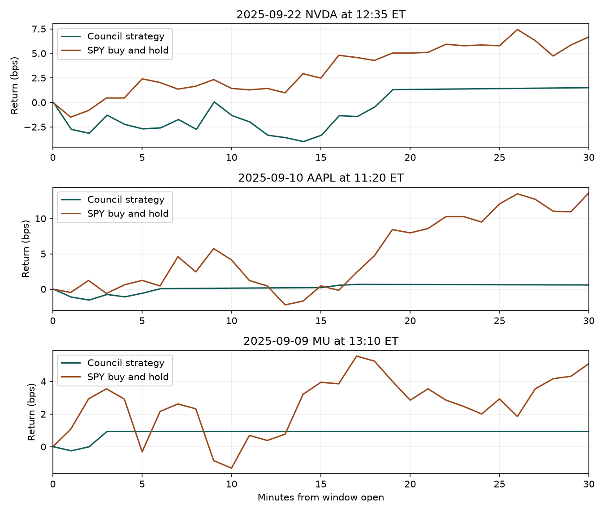
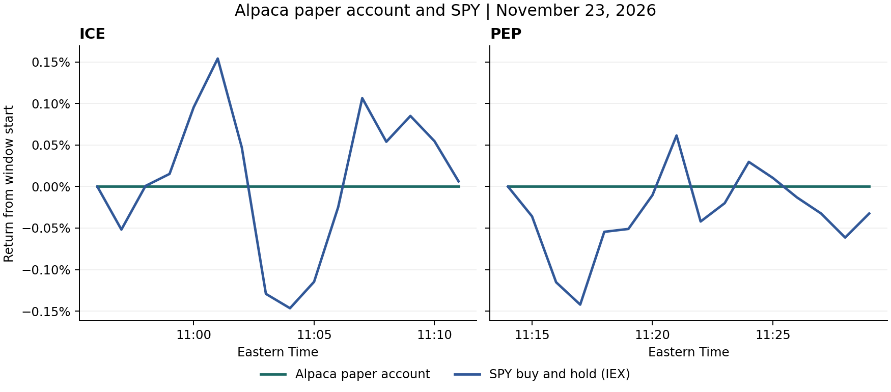

# 2. Historical simulation proof pack

Three 30-minute September 2025 windows used Alpaca SIP candles and quotes. Each began flat with $8,000 in virtual cash, with full council review and Skeptic off. The sample covers a long in MU, two shorts in AAPL, and a long in NVDA. The replay evaluated held positions at minute checkpoints. A positive executable quote triggered a fresh council review, and a profit-taking order still needed to be profitable when submitted. Existing stop protection and the cutoff remained in effect.

## Financial results

| Date | Ticker | Window ET | End equity | P&L | Return | Max observed drawdown | Filled orders | Closed / won | SPY return |
|---|---|---|---:|---:|---:|---:|---:|---:|---:|
| Sep 9, 2025 | MU | 13:10–13:40 | $8,000.75 | +$0.75 | +0.009375% | 0.0025% | 2 | 1 / 1 | +0.0508% |
| Sep 10, 2025 | AAPL | 11:20–11:50 | $8,000.48 | +$0.48 | +0.0060% | 0.0154% | 4 | 2 / 2 | +0.1364% |
| Sep 22, 2025 | NVDA | 12:35–13:05 | $8,001.20 | +$1.20 | +0.0150% | 0.0405% | 2 | 1 / 1 | +0.0668% |

The four closed trades yielded **+$2.43** in total and **4 of 4 wins**. All accounts ended flat. Returns use each window's own $8,000 ledger. Drawdown is based on recorded equity marks. The simulated fill price is the bid for a sale and ask for a buy, subject to the recorded limit and displayed depth. P&L reflects the spread and assumes zero additional fees. SPY is normalized to $8,000 at each window's open and held until that window's close. SPY returned more than the strategy over each selected window. Per-window numbers and SPY observations

| Ticker | Trade | Entry → exit | Held | P&L | Input → Chair, entry / exit |
|---|---|---|---:|---:|---:|
| MU | Long 5 | $136.35 → $136.50 | 2m 59s | +$0.75 | 3.88 / 3.10 s |
| AAPL | Short 3 | $227.15 → $227.09 | 6m 02s | +$0.18 | 3.56 / 5.22 s |
| AAPL | Short 3 | $226.63 → $226.53 | 2m 00s | +$0.30 | 3.56 / 3.33 s |
| NVDA | Long 4 | $183.70 → $184.00 | 19m 00s | +$1.20 | 3.43 / 3.76 s |

## Evidence to check

| Window | Orders | Strategy equity | SPY equity | Decision log |
|---|---|---|---|---|
| MU | CSV | CSV | CSV | JSONL |
| AAPL | CSV | CSV | CSV | JSONL |
| NVDA | CSV | CSV | CSV | JSONL |

Verified trades and order timestamps · [All 90 slots and council outputs](03-decision-journal.md)

## Broker-backed paper evidence

On November 23, 2026, the app ran ICE from 10:56 to 11:11 a.m. ET, then PEP from 11:14 to 11:29 a.m. ET. Alpaca confirmed zero orders, zero fills, and equity of $99,803.39 at both endpoints of each window. Paper return and sampled maximum drawdown were 0.00%. Win rate is undefined because there were zero closed trades. The matched SPY return was +0.0062% during ICE and −0.0324% during PEP.

[Original broker export contents and minute-by-minute comparison](paper-broker-evidence.md) · [Paper decision journal](paper-decision-journal.md)

This covers one trading date. Broker-backed fills and the three-session requirement remain outstanding.
